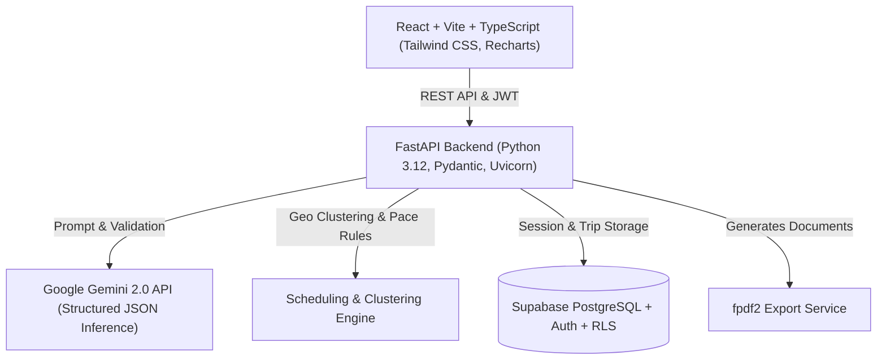

# TravelCraft AI — Your Intelligent Travel Companion

> **Capstone Project:** Personalized Travel Itinerary Planner  
> **Program:** Skill Wallet – Generative AI With Google Cloud

TravelCraft AI is a full-stack SaaS application that transforms travel preferences (destination, duration, budget, vibe, pace, dietary needs, group size) into optimized, structured, day-by-day travel itineraries. Powered by Google Gemini AI, FastAPI, React + Vite + TypeScript, and Supabase PostgreSQL.

---

## 🏗️ System Architecture



---

## 🌟 Key Features

1. **AI-Powered Day-by-Day Generation:** Tailors morning, afternoon, and evening activities with realistic timing, localized cost estimates, and transit notes.
2. **Deterministic Fallback & Demo Mode:** Fully functional out-of-the-box without requiring live credentials, offering curated demo data for Paris, Tokyo, Rome, and more.
3. **Route & Time Optimization:** Clusters attractions by district/area, avoids erratic backtracking, and balances sightseeing with mandatory meal breaks according to chosen pace (`relaxed`, `balanced`, `fast`).
4. **Single-Day Regeneration:** Allows regenerating individual days (e.g. Day 2) with custom user prompts while keeping all other days intact.
5. **Interactive Customization:** Real-time adding, editing, and deleting of activities with live recalculations of daily spending.
6. **Budget Management Dashboard:** Metric cards and interactive Recharts visualizations (category donut charts and daily spending schedules) with budget warning thresholds.
7. **Destination Discovery by Vibe:** Recommends 3 tailored global destinations based on climate, season, travel mood, and budget.
8. **Document Export:** PDF export with checklists and emergency notes, plus JSON import/export for data portability.
9. **Row-Level Security (RLS):** Supabase database migration scripts enforcing user data isolation.

---

## 🛠️ Technology Stack

| Layer | Technologies |
|---|---|
| **Frontend** | React 18, Vite, TypeScript, Tailwind CSS, React Router v6, Lucide React, Recharts |
| **Backend** | Python 3.12, FastAPI, Pydantic v2, Uvicorn, HTTPX, fpdf2, python-jose |
| **Generative AI** | Google Gemini API (`gemini-2.0-flash`) with structured schema output |
| **Database & Auth** | Supabase PostgreSQL, Supabase Auth, Row-Level Security (RLS) |
| **Deployment Targets** | Vercel (Frontend), Render (Backend), Supabase (Database) |

---

## 🚀 Local Development Setup

### 1. Prerequisites
- **Node.js** >= 18
- **Python** >= 3.11

### 2. Backend Setup
```bash
cd backend
python3 -m pip install -r requirements.txt
python3 -m uvicorn app.main:app --host 127.0.0.1 --port 8000 --reload
```
API Documentation will be available at: `http://127.0.0.1:8000/docs`

### 3. Frontend Setup
```bash
cd frontend
npm install
npm run dev
```
Web application will be available at: `http://localhost:5173`

---

## ⚙️ Environment Variables

### Backend (`backend/.env`)
```ini
GEMINI_API_KEY=your_gemini_api_key_here
SUPABASE_URL=https://your-project.supabase.co
SUPABASE_ANON_KEY=your_supabase_anon_key
SUPABASE_SERVICE_ROLE_KEY=your_supabase_service_key
CORS_ORIGINS=http://localhost:5173,http://localhost:3000,http://127.0.0.1:4173
DEMO_MODE=true
```

### Frontend (`frontend/.env`)
```ini
VITE_API_URL=http://127.0.0.1:8000
VITE_SUPABASE_URL=https://your-project.supabase.co
VITE_SUPABASE_ANON_KEY=your_supabase_anon_key
VITE_DEMO_MODE=true
```

---

## 🧪 Testing

### Backend Automated Test Suite
Run the 22 automated unit and integration tests:
```bash
cd backend
python3 -m pytest tests/ -v
```
**Test Coverage:**
- `test_schemas.py`: Trip preferences, date validation, negative budget prevention, activity types.
- `test_optimization.py`: Geographic clustering, pace-based activity counts, meal insertion, sorting order.
- `test_api.py`: `/health`, `/api/itineraries/generate`, `/api/itineraries/regenerate-day`, `/api/destinations/recommend`, `/api/trips` CRUD, and `/api/itineraries/export-pdf`.

### Frontend Build Verification
```bash
cd frontend
npm run build
```

---

## ☁️ Deployment Instructions

### Frontend on Vercel
1. Push repository to GitHub.
2. Link project in Vercel.
3. Set **Root Directory** to `frontend`.
4. Configure Build Command: `npm run build` and Output Directory: `dist`.
5. Set environment variable `VITE_API_URL` to your live Render backend URL.

### Backend on Render
1. Create a **New Web Service** pointing to your repository.
2. Set **Root Directory** to `backend`.
3. Set **Runtime** to `Python 3`.
4. Build Command: `pip install -r requirements.txt`
5. Start Command: `uvicorn app.main:app --host 0.0.0.0 --port $PORT`
6. Add environment variables: `GEMINI_API_KEY`, `SUPABASE_URL`, `SUPABASE_ANON_KEY`, and `CORS_ORIGINS`.

### Supabase Database
1. Navigate to your Supabase project's SQL Editor.
2. Execute `supabase/schema.sql` to instantiate the `profiles`, `trips`, `itinerary_days`, and `itinerary_activities` tables along with triggers and RLS policies.

---

## 📋 Skill Wallet Milestone Coverage

- **EPIC 1:** Environment setup, clean directory structure, Git configuration.
- **EPIC 2:** Supabase schema with RLS policies, profiles, trips, and activities.
- **EPIC 3:** Multi-factor preference capture and AI destination recommendation engine.
- **EPIC 4:** Structured day-by-day itinerary planner, geographic grouping, meal breaks, and single-day regeneration.
- **EPIC 5:** SaaS trip library, interactive editing, budget tracking charts, and PDF/JSON export.
- **EPIC 6:** Production configuration for Vercel and Render deployment.
- **EPIC 7:** Automated testing, documentation, and verification.
